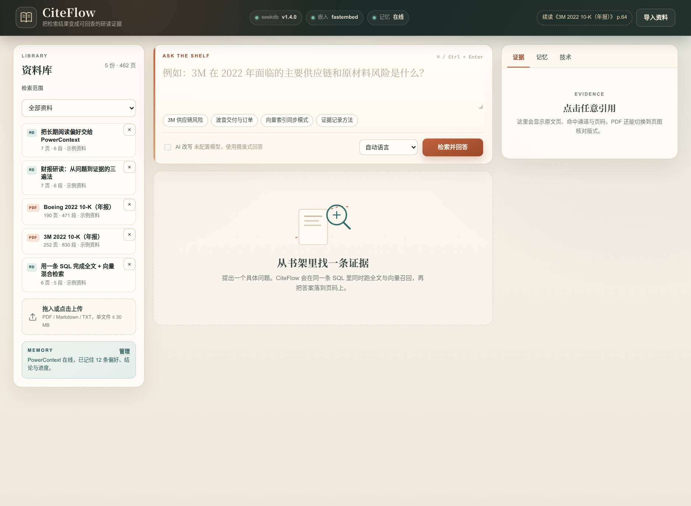

# CiteFlow · 研读工作台

把论文、财报和课程笔记导入本地书架，用**一条 SQL** 同时跑全文与向量召回，把每个结论落回可核对的原文页码；再用 PowerContext 记住阅读偏好与进度，下次打开还能接着读。

> 2026 OceanBase 数据库大赛 · Qoder 生态赛题作品  
> 代码仓库：<https://github.com/AndyCuihaoyi/powercontext-2026/tree/2026-competition-ecosystem/qoder>  
> 项目网站：发布后回填（源文件在 `site/`）



## 它解决什么问题

- **读完就忘**：几十份 PDF 里翻不到上次看到的那一页。
- **搜到却不敢用**：通用问答给了一段话，却不知道来自哪份文件、哪一页。
- **换会话就失忆**：每次都要重新说明“先给结论、保留页码、关注现金流”。
- **离线不可用**：很多 RAG demo 依赖云端模型和 API Key，评审环境跑不起来。

CiteFlow 把「导入 → 混合检索 → 证据页 → 记忆 → 统计」做成一个本地优先的闭环。没有模型 Key 也能完整运行：本地多语言嵌入 + 摘录式回答；配置任意 OpenAI 兼容模型后，可切换为综述式回答，引用仍只来自检索结果。

## 核心功能

| 功能 | 说明 |
| --- | --- |
| 多格式书架 | PDF、Markdown、TXT 上传，按集合管理，重复文件按 SHA-256 去重 |
| 单 SQL 混合检索 | 同一条 statement 内完成 IK 全文召回、HNSW 向量召回、集合/文档过滤 |
| 可核对证据 | 每条要点带 `[n]`，右侧直接打开原文页；PDF 可切换页图核对版式 |
| 证据排序 | RRF 融合 + `rank^1.5` 抑制弱一致 + 标题实体加权 |
| 记忆与进度 | PowerContext 保存偏好、结论、阅读进度；新会话自动召回并注入回答 |
| 透明降级 | PowerContext 不可用 → seekdb 镜像记忆；嵌入模型不可用 → 确定性 hash 向量；均在 UI 明示 |
| 使用统计 | 查询次数、命中通道、p50/p95、最近查询，全部来自真实查询日志 |
| 离线可跑 | 本地 ONNX 嵌入，无 API Key 启动；LLM 只是可选增强 |

## 技术亮点

### 一条 SQL 同时跑两类索引

`app/retrieval.py` 用两个派生表 + `ROW_NUMBER()` + `UNION ALL` 返回两路有序候选，应用层只做 RRF：

```sql
SELECT id, document_id, page_no, heading, text, channel, rank_in_channel, channel_score
FROM (
  SELECT c.*, 'fts' AS channel,
         ROW_NUMBER() OVER (ORDER BY MATCH(c.text) AGAINST (%s) DESC) AS rank_in_channel,
         MATCH(c.text) AGAINST (%s) AS channel_score
  FROM cf_chunks c
  WHERE 1 = 1 AND c.collection_id = %s AND c.document_id IN (...)
    AND MATCH(c.text) AGAINST (%s)
  ORDER BY MATCH(c.text) AGAINST (%s) DESC
  LIMIT 24
) fts
UNION ALL
SELECT id, document_id, page_no, heading, text, channel, rank_in_channel, channel_score
FROM (
  SELECT c.*, 'vector' AS channel,
         ROW_NUMBER() OVER (ORDER BY l2_distance(c.embedding, %s) ASC) AS rank_in_channel,
         l2_distance(c.embedding, %s) AS channel_score
  FROM cf_chunks c
  WHERE 1 = 1 AND c.collection_id = %s AND c.document_id IN (...)
  ORDER BY l2_distance(c.embedding, %s) APPROXIMATE
  LIMIT 24
) vec
```

带文档过滤时，seekdb 的实际执行计划会同时出现：

```text
|5 |│       └─TEXT RETRIEVAL SCAN                    |c(cf_ft)       |
|10|        └─VECTOR INDEX ADAPTIVE SCAN (PRE-FILTER)|c(cf_chunk_doc)|
```

完整 SQL、索引 DDL 和计划片段见 [`docs/architecture.md`](docs/architecture.md) 与 [`docs/verification.md`](docs/verification.md)。

### PowerContext 真正参与回答

不是“只连了一下”：

1. 阅读某页时，进度写入 PowerContext，并镜像到 seekdb `cf_memories`；
2. 提问时，`memory.recall()` 调 `/v1/memory/search`，把命中的偏好/结论注入 `applied_memories`；
3. 右侧「记忆」页可调用 `/v1/context/prepare` 预览本次会注入的上下文；
4. PowerContext 停机时自动回落到 seekdb 镜像，UI 标记 `seekdb-fallback`。

验证记录中的真实请求 ID、entry ID 和 context 字节数见 [`docs/verification.md`](docs/verification.md)。

### 回答不越出证据

- 默认摘录式：只从命中的 chunk 里选句，每条 bullet 必须带引用；
- 同一文档类型聚焦：避免中文笔记污染英文财报问题；
- 近似重复句去重：10-K 跨页重复披露只保留一次；
- 引用列表只保留真正被用到的页，UI 不会给你 8 个用不上的 citation；
- 可选 LLM 只负责组织表达，system prompt 明确禁止补充外部事实。

## 架构

```text
浏览器（原生 HTML/CSS/JS）
   │ /api/*
FastAPI（app/server.py）
   ├── ingest.py      PDF/MD/TXT 解析、切块、批量嵌入、入库
   ├── embeddings.py  fastembed 多语言模型 / hash 降级
   ├── retrieval.py   单 SQL 混合检索 + RRF + EXPLAIN 记录
   ├── answer.py      证据抽取 / 可选 OpenAI 兼容 LLM
   ├── memory.py      PowerContext HTTP / seekdb 镜像降级
   └── db.py          pymysql、schema、查询日志、统计
        │
   seekdb 1.4（MySQL 协议，127.0.0.1:2891）      PowerContext 1.2（127.0.0.1:17429）
   ├── cf_documents                               ├── /v1/scopes
   ├── cf_chunks（FULLTEXT ik + VECTOR hnsw）      ├── /v1/memory/remember
   ├── cf_queries                                 ├── /v1/memory/search
   └── cf_memories（降级镜像）                     └── /v1/context/prepare
```

## 快速开始

### 1. 前置条件

- Python 3.11+（本文验证环境：3.12.3）
- seekdb 1.4.x（MySQL 协议，默认端口 2891）
- 可选：PowerContext 1.2+（默认端口 17429）
- 可选：首次运行需联网下载约 220 MB 的嵌入模型；离线环境可设 `CITEFLOW_EMBEDDING_BACKEND=hash`

seekdb 安装方式见官方仓库 <https://github.com/oceanbase/seekdb>。安装后确保 `seekdb` 在 `PATH`，或设置：

```bash
export SEEKDB_BIN=/path/to/seekdb
```

PowerContext 安装：

```bash
uv tool install powercontext
# 或 pipx install powercontext
```

### 2. 启动

```bash
git clone -b 2026-competition-ecosystem https://github.com/AndyCuihaoyi/powercontext-2026.git
cd powercontext-2026/qoder

cp .env.example .env          # 可选：改端口、关掉 PowerContext、配置 LLM
scripts/run.sh                # 创建 .venv、启动 seekdb、可选启动 PowerContext、启动 CiteFlow
```

打开 <http://127.0.0.1:8848>。首次启动会后台加载嵌入模型，状态条会从 `pending` 变为 `fastembed · 384d`；模型不可用时自动显示 `hash` 降级。

### 3. 导入样例并验证

页面上点击「导入样例」，或者在另一个终端执行：

```bash
.venv/bin/python scripts/seed_demo.py
.venv/bin/python scripts/verify_demo.py
```

`verify_demo.py` 会跑 4 个代表性问题 + 1 个文档过滤查询，检查：

- seekdb 与嵌入后端状态；
- 每次查询的全文/向量双通道命中；
- 引用页能否通过 `/api/documents/{id}/page/{n}` 回查；
- EXPLAIN 是否同时包含 `TEXT RETRIEVAL SCAN` 与 `VECTOR INDEX`；
- PowerContext 写入、检索、`context.prepare`、回答注入；
- 查询日志与延迟统计。

结果写入 `runtime/verify_report.json`，完整步骤与预期输出见 [`docs/verification.md`](docs/verification.md)。

### 4. 手动运行（不使用脚本）

```bash
python3 -m venv .venv
.venv/bin/python -m pip install -r requirements.txt
scripts/start_seekdb.sh
set -a; . ./.env; set +a        # 如果使用 .env
.venv/bin/python -m app.server
```

## 配置

复制 `.env.example` 为 `.env`。常用变量：

| 变量 | 默认值 | 说明 |
| --- | --- | --- |
| `CITEFLOW_SEEKDB_HOST` / `PORT` | `127.0.0.1` / `2891` | seekdb 连接 |
| `CITEFLOW_SEEKDB_DATABASE` | `citeflow` | 数据库名，首次启动自动建表 |
| `CITEFLOW_EMBEDDING_BACKEND` | `auto` | `auto` / `fastembed` / `hash` |
| `CITEFLOW_HF_ENDPOINT` | 空 | HuggingFace 镜像，如 `https://hf-mirror.com` |
| `CITEFLOW_POWERCONTEXT` | `auto` | `auto` / `off`；`auto` 不可用时自动降级 |
| `CITEFLOW_POWERCONTEXT_URL` | `http://127.0.0.1:17429` | PowerContext 地址 |
| `CITEFLOW_LLM_BASE_URL` / `API_KEY` / `MODEL` | 空 | 三项齐全才启用 LLM；配置示例见 `.env.example` |
| `CITEFLOW_PORT` | `8848` | Web 端口 |
| `CITEFLOW_MAX_UPLOAD_MB` | `30` | 单文件上限 |

> `.env` 由 `scripts/run.sh` 加载；直接 `python -m app.server` 时请自行 `export`。密钥只放在 `.env` 或环境变量中，不要提交。

## 测试

```bash
# 单元测试（不需要 seekdb）
.venv/bin/python -m pytest

# 加跑 seekdb 集成测试
CITEFLOW_TEST_SEEKDB=1 .venv/bin/python -m pytest
```

当前环境结果：`14 passed`。集成测试会使用临时集合导入一条 probe 文档，验证入库、双通道召回和 EXPLAIN，然后清理；需要 seekdb 已启动。

截图（需要 Playwright Chromium）：

```bash
.venv/bin/python -m pip install -r requirements-dev.txt
.venv/bin/python -m playwright install chromium
.venv/bin/python scripts/capture_screenshots.py
```

## 目录

```text
app/
  server.py        HTTP API + 静态页面
  ingest.py        PDF/MD/TXT 解析、切块、入库
  retrieval.py     单 SQL 混合检索、RRF、EXPLAIN
  answer.py        摘录式回答 / 可选 LLM
  memory.py        PowerContext + seekdb 镜像
  db.py            schema、日志、统计
  web/             原生前端
data/samples/      2 份公开 10-K + 3 份中文笔记
scripts/           启动、导入、验证、截图
tests/             单元 + 可选集成测试
docs/              架构说明、验证样例
site/              Qoder Sites 静态站源文件
DEVLOG.md          Qoder 开发记录
```

## 样例数据与来源

- `data/samples/3M_2022_10K.pdf`、`data/samples/BOEING_2022_10K.pdf`：美国 SEC EDGAR 公开的 2022 年 10-K 文件，经 FinanceBench 数据集镜像整理（<https://github.com/patronus-ai/financebench>），本项目仅重命名，未改动内容。
- 3 份中文 Markdown 笔记为本项目撰写，用于演示中文全文检索、跨语言检索和记忆场景。
- 嵌入模型：`sentence-transformers/paraphrase-multilingual-MiniLM-L12-v2`（384 维，Apache-2.0），经 fastembed 在本地 ONNX/CPU 运行。
- seekdb、PowerContext 的许可证与使用条款见各自仓库。

## 安全与隐私

- 默认只监听 `127.0.0.1`，文档不上传到任何第三方；
- 样例与验证数据均为公开财报和自写笔记；
- 仓库不包含 API Key、Token、密码；`runtime/`、`.env` 已被忽略；
- LLM 为可选功能；不配置时完全离线运行。

## Qoder 开发记录

项目在 Qoder 会话中完成需求拆解、技术探针、编码、调试与自测。分阶段记录（含失败与修复）见 [`DEVLOG.md`](DEVLOG.md)。关键节点：

1. 读取赛题与工作区，确定「可回查证据的研读助手」方向；
2. 在 seekdb 1.4 上验证 IK 全文 + HNSW 向量 + 单 SQL 执行计划；
3. 实现解析/切块/嵌入/入库、混合检索、RRF、摘录式回答；
4. 实现原生前端、页码证据面板、记忆页与统计；
5. 用 Playwright 做浏览器自测，修掉 CSS `hidden`、引用自动打开、EXPLAIN 截断等缺陷；
6. 建立 14 个测试与端到端验证脚本，生成站点素材。

## License

本项目代码用于 2026 OceanBase 数据库大赛 Qoder 赛题提交。第三方依赖、样例数据与模型遵循各自许可证；转载或复用请保留来源说明。
